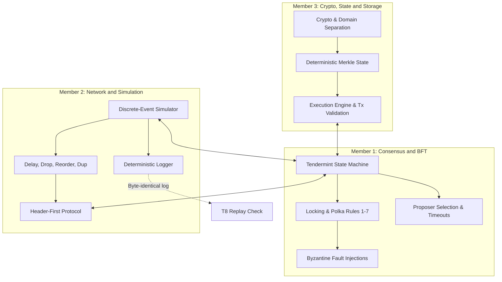

# Lab 01: Layer 1 Blockchain Simulator - 3-Member Team Task Plan

## Goal Description

Design and implement a minimal Layer 1 blockchain achieving BFT finality over a simulated unreliable network ($n \ge 8$ nodes, $n = 3f + 1$, up to $f$ Byzantine validators). The system implements domain-separated cryptography, header-first propagation, Tendermint-style 2-phase consensus with locking rules, deterministic Merkle state transitions, and byte-identical determinism under re-execution.

The baseline is **10 validators**, with $f = 3$ and a quorum of $2f + 1 = 7$ distinct valid votes. This is the smallest configuration satisfying both node-count constraints. Keep the validator set fixed per run and reject configurations that do not satisfy $n \ge 8$ and $n = 3f + 1$.

The objective of this plan is to divide the workload among **3 team members** with clear interface boundaries, balanced scope, independent testability, and full alignment with the Lab 01 submission regulations.



---

## User Review Required

> [!IMPORTANT] **Implementation Language**: **Python 3.11+** (using `dataclasses`, `hashlib`, `cryptography` / `ed25519`, and `asyncio` or custom discrete-event loop) for rapid development and clean determinism control.

---

## Member Work Breakdown & Task Allocation

### Member 1: Consensus Engine & Byzantine Fault Tolerance

**Role Focus**: Protocol correctness, BFT state machine, locking guards, and adversarial behavior.

- **Key Deliverables**:
  1. **Consensus State Machine** (`src/consensus/`):
     - Implement 2-phase BFT voting: `PREVOTE` and `PRECOMMIT`.
     - Deterministic round-robin proposer rotation across heights and rounds.
     - Round timeout handling (`TimeoutPropose`, `TimeoutPrevote`, `TimeoutPrecommit`) when proposer crashes or is silent.
  2. **Consensus Locking Rules** (Section 6.1, Rules 1–7):
     - Rule 1 & 2: Sign at most one Prevote and one Precommit per `(height, round)`.
     - Rule 3: Validate block proposal (valid parent hash, valid txs, state root match, correct proposer for the height and round, and valid header signature).
     - Rule 4: Quorum of $2f + 1$ distinct valid PREVOTEs for the same non-NIL block $B$ at the same height and round $\implies$ lock block $B$ and record that round in `locked_round`.
     - Rule 5: While locked on $B$, prevote a different block $B'$ only after observing $2f + 1$ distinct valid PREVOTEs **for that replacement block $B'$**, at the same height, in a round $> locked\_round$. A later-round quorum for the already locked block or any other block does not authorize switching to $B'$.
     - Rule 6: Before locally signing any vote, reject an incorrect chain ID, height, round, phase, or domain for the intended signing context. Member 1 owns these signing guards and incoming-vote validation; Member 3 supplies the canonical signing/verification helpers. Validate the corresponding fields and signature on incoming votes before counting them.
     - Rule 7: Duplicate vote suppression (at most one vote per validator per `(height, round, phase)`).
  3. **Byzantine Fault Injection Engine** (`src/byzantine/`):
     - Equivocation (sending conflicting votes to different peers).
     - Silent/crashed proposer behavior.
     - Invalid block generation (bad transactions, invalid state hash).
     - Outdated vote and replay attacks.
  4. **Assigned Tests**:
     - **T1**: Normal run with no faults (all honest nodes reach same finality).
     - **T6**: Proposer silent/crashed (round timeouts trigger and consensus progresses).
     - **T7**: Up to $f$ Byzantine validators equivocate (safety preserved, zero conflicting blocks finalized).
     - **Consensus unit tests** (`tests/test_consensus.py`, Member 1): Cover vote counting and locking guards. Permit switching with a valid later-round quorum for the replacement block; refuse switching when the evidence is for the already locked block or another block, is at another height, has insufficient votes, or is at/below `locked_round`. Test each incorrect chain ID, height, round, phase, and domain on both the local signing path and incoming validation.
     - **Block-validation unit tests** (`tests/test_block_validation.py`, Member 1, with state/crypto fixtures from Member 3): Accept a fully valid proposal; independently reject an invalid parent, invalid transactions (signature, domain, ownership, or replay), a mismatched state commitment, a wrong proposer, and an invalid header signature. Rejection must leave committed state unchanged.

---

### Member 2: Network Simulation, P2P Layer & Deterministic Logging

**Role Focus**: Asynchronous message passing, link unreliability, rate limiting, and reproducible logging.

- **Key Deliverables**:
  1. **Discrete-Event Simulator** (`src/network/simulator.py`):
     - Virtual clock / tick-based event queue ensuring deterministic execution across identical seeds.
     - Configurable node topology supporting $n \ge 8$ and $n = 3f + 1$ (matrix or file-driven latency/connectivity configurations); use the 10-validator, $f = 3$ baseline.
  2. **Unreliable Transport Layer** (`src/network/link.py`):
     - Simulated faults: random delays, message duplication, out-of-order delivery, and packet drops before the stabilization instant `T_stabilize`.
     - Keep `T_stabilize` separate from $\Delta$, the known maximum delivery delay after stabilization. The simulator configures the transition instant; correct nodes do not know it in advance. Every message sent between correct nodes at or after `T_stabilize` must be delivered without drops within $\Delta$, including queueing time. Configure rate limiting and peer blocking to preserve that bound for correct-node traffic. Require liveness after stabilization once a correct proposer is selected.
  3. **Traffic Control & Header-First Propagation** (`src/network/p2p.py`):
     - Outbound rate limiting per node and temporary blocking of overactive peers.
     - Header-first protocol: broadcast `BlockHeader` first; transfer `BlockBody` only upon explicit peer request after header acceptance.
  4. **Deterministic Event Logger** (`src/logging/`):
     - Unified structured logger for all network events: `send`, `drop`, `delay`, `block`, `unblock`, and consensus transitions.
     - Standard log line format: `[TIMESTAMP] [NODE_ID] [EVENT_TYPE] [HEIGHT] [ROUND] [DETAILS]`.
  5. **Assigned Tests**:
     - **T2**: Duplicate & reordered messages (verified suppression and no double counting).
     - **T5**: Drop & delay before `T_stabilize`: safety throughout the run requires equal finalized block hashes at every shared height across correct nodes; temporary differences in finalized heights are allowed. Assert delivery without drops within $\Delta$ for correct-node messages sent at or after stabilization, and separately verify eventual catch-up and continued finalization once a correct proposer is selected.
     - **T8**: Determinism audit: Run identical seed twice and verify byte-identical logs and final state hash.

---

### Member 3: Cryptography, State Execution, CLI & Project Lead

**Role Focus**: Cryptographic integrity, deterministic data storage, execution engine, test runner, and submission package.

- **Key Deliverables**:
  1. **Cryptography & Serialization Layer** (`src/crypto/`):
     - Ed25519 (or secp256k1) keypair generation and verification.
     - Strict domain separation strings: `TX:chain_id`, `HEADER:chain_id`, `VOTE:chain_id`.
     - Canonical deterministic byte encoding for hashing and signing (fixed endianness, sorted map keys).
     - Vote signing bytes bind chain ID, height, round, phase, and block hash under `VOTE:chain_id`; provide helpers for Member 1's local signing guards and incoming validation.
  2. **State & Execution Engine** (`src/core/state.py`):
     - Key-Value state model for Decentralized Document Notarization:
       - `<sender>/nonce` (`"<uint64>"`): sequential transaction counter for replay protection.
       - `<sender>/docs/<doc_id>` (`"0x<sha256_hex>"`): document cryptographic digest / proof-of-existence.
     - Access control enforcement: transactions modify **only** keys strictly prefixed with the signer's identity/namespace (`<sender>/...`).
     - Canonical Merkle Tree / Patricia Trie computing the deterministic state commitment hash across all sorted key-value records.
     - Block execution pipeline: apply valid document notarization transactions deterministically, update state root, produce execution receipts.
  3. **Configuration & Unified Test CLI** (`tests/run_e2e.py`):
     - Single entry point to execute unit tests and all integration scenarios T1–T8.
     - CLI flags for configuring nodes, seeds, fault injection, output logs, `T_stabilize`, and $\Delta$ independently. Default to $n = 10$, $f = 3$, quorum 7; validate node-count constraints and derive the quorum from $f$.
  4. **Assigned Tests**:
     - **T3**: Invalid signature & cross-domain replay rejection.
     - **T4**: Replayed and duplicate transaction rejection.
     - Unit tests for crypto, canonical serialization, and state transition.
  5. **Submission & Documentation Lead**:
     - Author `README.md` (build instructions, running simulation, test execution).
     - Lead `REPORT.pdf` authoring: Compile architecture diagrams, module explanations, bug resolution notes, and experimental results from all 3 members.
     - Obtain and record instructor confirmation of the three-member naming before packaging. The packaging script (`scripts/pack_submission.py`) must use one confirmed `submission_name` for both the root folder and `<submission_name>.zip`; the required template is `Lab01_ID1_ID2_ID3_ID4_ID5` unless the instructor explicitly approves an alternative. Reject unresolved naming, placeholder IDs, or a folder/archive name mismatch.

---

## Detailed Component File Structure

The root below uses the lab's prescribed template pending instructor confirmation for three members. Apply any approved alternative consistently to this root, the archive name, and `scripts/pack_submission.py` through the single `submission_name` setting.

```text
Lab01_ID1_ID2_ID3_ID4_ID5/
├── config/
│   ├── network_topology.json       # Node connection matrix and latencies (M2)
│   └── genesis.json                # Initial validator set and chain ID (M3)
├── src/
│   ├── core/
│   │   ├── types.py                # Tx, Block, Header, Vote data structures (M3)
│   │   ├── state.py                # Key-Value state and Merkle root logic (M3)
│   │   └── executor.py             # State transition function & execution receipts (M3)
│   ├── crypto/
│   │   ├── keys.py                 # Ed25519 key management (M3)
│   │   ├── sign.py                 # Domain-separated signature verification (M3)
│   │   └── encoding.py             # Canonical deterministic byte serializer (M3)
│   ├── consensus/
│   │   ├── engine.py               # Tendermint 2-phase state machine (M1)
│   │   ├── rules.py                # Locking & prevote/precommit validation rules 1-7 (M1)
│   │   └── proposer.py             # Round-robin proposer selection & timeout logic (M1)
│   ├── byzantine/
│   │   └── behaviors.py            # Equivocation, silent proposer, invalid blocks (M1)
│   ├── network/
│   │   ├── simulator.py            # Discrete-event simulation loop (M2)
│   │   ├── link.py                 # Delay, drop, duplicate, reorder pipeline (M2)
│   │   └── p2p.py                  # Header-first gossip, rate-limiter, peer banning (M2)
│   └── logging/
│       └── logger.py               # Deterministic formatted event logger (M2)
├── tests/
│   ├── test_crypto.py              # Unit tests for crypto & serialization (M3)
│   ├── test_state.py               # Unit tests for state updates & access control (M3)
│   ├── test_consensus.py           # Unit tests for locking, signing guards & vote counting (M1)
│   ├── test_block_validation.py    # Unit tests for valid/invalid proposals (M1; M3 fixtures)
│   ├── test_network.py             # Unit tests for rate-limiting & header-first flow (M2)
│   └── run_e2e.py                  # Single entry point for unit suites and T1-T8 (M3)
├── logs/                           # Deterministic logs output
├── scripts/
│   └── pack_submission.py          # Validate confirmed naming/structure and zip (M3)
├── README.md                       # Setup and run guide (M3)
└── REPORT.pdf                      # Comprehensive technical report (All)
```

---

## Verification Plan

### Automated Tests

Run all unit and end-to-end tests from the single entry point using the default 10-validator configuration ($f = 3$, quorum 7):

```powershell
# Run full suite (Unit + T1-T8)
python -m tests.run_e2e --all

# Run specific lab scenarios
python -m tests.run_e2e --scenario T1  # Normal run, convergence check
python -m tests.run_e2e --scenario T7  # Up to f Byzantine equivocations
python -m tests.run_e2e --scenario T8  # Determinism replay check (compares SHA256 of log1 vs log2)
```

### Verification Criteria Checklist

- [ ] **Baseline configuration**: Use $n = 10$, $f = 3$, quorum 7; reject configurations violating $n \ge 8$ or $n = 3f + 1$.
- [ ] **Mandatory unit suites**: Crypto verification/context checks and state updates (Member 3); vote counting/locking/signing guards and block validation (Member 1); network controls/header-first flow (Member 2). Block-validation coverage includes a valid proposal and independent invalid-parent, transaction, state-commitment, proposer, and header-signature cases.
- [ ] **Rule 5**: Switching to a replacement block requires a quorum for that same block at the same height in a round later than `locked_round`; other quorums do not satisfy the guard.
- [ ] **Rule 6**: Local signing refuses each incorrect chain ID, height, round, phase, and domain; incoming votes undergo the corresponding field and signature checks.
- [ ] **T1**: All honest nodes finalize the exact same block sequence and final state hash.
- [ ] **T2**: Duplicated votes and reordered packets cause no double-counting or forks.
- [ ] **T3**: Invalid signatures or mismatched domains (`TX:` vs `VOTE:`) are rejected and logged.
- [ ] **T4**: Replayed transactions are rejected; state changes applied at most once.
- [ ] **T5 safety**: No different blocks finalize at the same height at any time, including during high delay and packet drops before `T_stabilize`. Compare finalized hashes at heights shared by correct nodes; allow temporary height lag.
- [ ] **T5 stabilization and liveness**: Correct-node messages sent at or after `T_stabilize` arrive without drops within $\Delta$. Separately verify eventual catch-up and continued finalization after stabilization and selection of a correct proposer.
- [ ] **T6**: When the proposer is crashed, round timeouts advance and next honest proposer finalizes block.
- [ ] **T7**: $f$ Byzantine validators equivocating simultaneously cannot finalize a fork.
- [ ] **T8**: Running twice with the same seed yields byte-identical log output and matching state hash.
- [ ] **Submission naming**: Member 3 has recorded instructor confirmation for the three-member team, supplied actual IDs, and configured identical root/archive base names in the packaging script; no unresolved placeholders remain in the submission.
